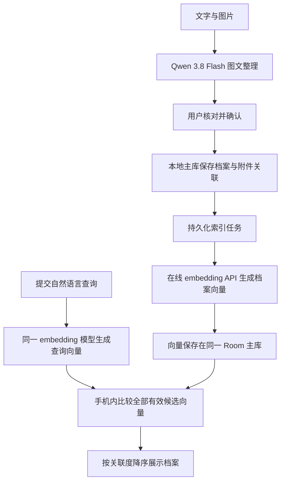

# 自建档案 Bot 功能拆解与本地化方案

档案 Bot 用于手机本地保存证件、银行卡资料、地址、资料链接及附件，保留“图文整理草稿 → 核对 → 确认保存”的流程。按 2026-10-27 用户补充，AI 整理与 embedding 均使用在线 API，默认查询使用语义关联度排序。Matrix、R2/S3 和服务器进程均从新版迁移范围移除。已按步骤 1–3 接入共用主库、真实本地页面、独立会话及[千问图文整理](../design/archive-ai.md)；步骤 4–6 的修改核对、在线向量与默认语义查询实现见[确认管理与语义检索](../design/archive-search.md)。

向量生成、向量存放、相似度计算是三个独立选择：在线模型生成向量，向量与正式档案留在手机，手机完成相似度计算。建议首版使用现有 Room/SQLite 保存二进制向量，由 Kotlin 比较余弦相似度；暂不新增专用向量数据库或端侧模型运行时。

## 已确认的产品取舍（2026-10-27）

| 项目 | 当前决定 |
| --- | --- |
| AI 整理 | 使用与日程相同的 `qwen3.8-flash` 在线 API，同时提供当前文字和真实图片输入 |
| 向量生成 | 使用独立的在线 embedding API；不部署手机端嵌入模型 |
| 默认搜索 | “我的中国银行卡”“我的身份证”等自然语言直接生成查询向量，按语义分数降序排列 |
| 排序规则 | 不强制字符串完全命中，不按关键词命中置顶，不把关键词分数伪装为语义分数 |
| AI 会话范围 | 一次会话只处理一个档案问题，消息、草稿与附件按会话隔离；保存后固定绑定一个档案，不能切换目标或创建第二条档案 |
| 本地持久化 | 共用 mebot 主库保存正式数据与派生向量，附件原件保存在手机持久文件中 |
| 离线边界 | 浏览、手动管理及本地文字查找仍可用；在线语义搜索失败时如实提示，不把文字查找冒充语义结果 |

此前的“优先端侧嵌入、精确匹配优先、关键词与语义混合排序”建议已被上述决定替代。新增或修改一条档案只需重新索引该条；查看详情无需调用模型，提交一次搜索通常只调用一次查询 embedding。

## 工作区与分析依据

| 项目 | 内容 |
| --- | --- |
| 会话角色 | 自建档案功能开发，当前先出方案 |
| 分支 | `codex/archive` |
| mebot 起点 | `836c03dc16cb8bc714667f14cee185513f6c8376`，主库 schema 14 |
| 本次续分析基线 | `ba0dd8c`，应用 0.21.7、主库 schema 14；已包含此前档案方案的集成与回流 |
| 旧版分析来源 | `archive` 的当前源码，2026-10-26 阅读 |
| 旧版 HEAD | `31a78b1d68625e364aefc67b380b2f03b949513a` |

旧版工作区包含未提交修改：整理器、业务服务、存储、相关测试与 README 已修改，链接解析器及其测试尚未跟踪。以下结论依据实际文件，不能把旧版 HEAD 当成完整分析快照。本轮未修改旧项目、读取其 `.env`、个人数据库或访问其 Matrix/R2 服务。

主要源码依据：

- 业务与确认流程：新增、修改、删除、查询、分页与会话状态。
- 存储与检索：加密 payload、SQLite、编号及余弦相似度。
- 向量接口：DashScope 和 OpenAI 兼容接口。
- 整理器：结构化草稿、图片输入、冲突与链接保护。
- Matrix 入口、远程媒体、网页链接解析。

## 旧版实际功能与新版取舍

| 功能 | 旧版实际行为 | 新版建议 |
| --- | --- | --- |
| 文字建档 | 所有普通文字先请求 AI，生成标题、类型、标签及完整 Markdown 表格 | 保留 AI 整理，增加离线手动建档；未配置模型也能保存 |
| 图片整理 | 开启视觉能力后，把图片交给多模态模型提取内容 | 当前文字与选中图片一并发送给 `qwen3.8-flash`；本地附件先保存可靠副本 |
| 草稿确认 | 展示完整整理稿，`confirm` 后写库，`cancel` 放弃 | 改为明确按钮；草稿、输入与相关消息落主库，退出或进程重启后可继续 |
| 冲突处理 | 文字与图片的关键信息冲突时阻止确认；用户明确给出的修正值优先 | 保留核对流程；人工编辑可直接解决冲突，模型输出仍由本地校验 |
| 继续对话修改 | 一个房间保留一份内存草稿，后续消息修订该草稿 | 按用户要求一次会话只处理一个档案；新建保存后固定绑定该档案，继续修改也不切换对象 |
| 网页链接 | 保存原始 HTTP(S) 地址、数量与顺序，AI 只能生成显示名 | 保留；原始 URL 是业务数据，标签可修改，模型不能篡改地址 |
| 附件 | 图片、视频、音频、通用文件经 Matrix 上传 R2，正文保存 `r2://` 引用 | 改为系统选择器导入、本地持久文件与 Room 关联；新数据不生成远程存储引用 |
| 内容识别范围 | 图片可发视觉模型；其他媒体主要提供文件名和类型 | 首版保存及打开附件；PDF 正文提取、录音转写、视频理解另列后续能力 |
| 链接内容 | 解析并保留 URL，没有网页抓取、正文解析或网页快照 | 首版继续只保存链接，不能声称已索引网页全文 |
| 档案详情 | 按编号或搜索结果序号查看，包含元信息与确认后的 Markdown | 本地详情展示字段、附件、链接，支持复制字段、打开附件与编辑 |
| 修改 | AI 生成完整替换草稿，确认后覆盖旧 payload 和向量 | 手动或 AI 修订，确认后事务更新并立即使旧向量失效；变更版本留存可作为后续增强 |
| 删除 | 按准确 ID 二次确认，只删数据库记录，R2 对象保留 | 明确删除范围；同步删除索引关联，解除附件引用，仅清理无其他引用的文件 |
| 列表 | 全量读取、按创建时间升序，`list` 不分页 | 最近更新优先、按需分页；类型及标签筛选不依赖模型 |
| 查询 | 向量余弦与整段字符串包含匹配混合，搜索每页最多 10 条 | 默认只按语义关联度排序，展示档案卡片与命中片段；本地文字查找独立作为备用能力 |
| 阈值 | 全局默认 0.05，可发送 `set similarity N%` 修改 | 首版按分数排序及分页，不设用户必须调节的最低阈值，不把分数显示为正确率 |
| 编号 | `YYMMDD` 加一个大小写字母，每天最多 52 条 | 内部稳定 UUID；显示编号可用日期加递增序号，不沿用每日 52 条限制 |
| 加密 | Fernet 加密标题、正文、标签、链接等 payload；向量 JSON、模型及来源元数据未加密 | 保留保护档案内容的目标，Android 密钥管理单独适配，向量也按敏感派生数据处理 |

旧版的 `markdown_original` 保存的是用户确认后的整理稿，原始输入与对话历史没有单独持久保存。新版建议同时保存原始输入、已确认内容与附件关联，以便核对来源；业务状态以 Room 中的正式记录为准。

## Matrix 与远程运行组件的移除范围

| 组件 | 新版移除内容 | 本地替代 |
| --- | --- | --- |
| `matrix_client.py` | 账号登录、加入房间、历史跳过、增量同步、事件去重、发送回复、正在输入状态、`mxc://` 下载 | Compose 操作、ViewModel 状态、本地操作 ID 与真实执行结果 |
| `agent.py` / `archive_service.py` | `MatrixEvent`、房间及发送者作为业务参数、按房间暂存草稿与结果 | 档案用例、本地 sessionId/recordId、Repository；保留草稿确认等业务规则 |
| `archive_store.py` 来源字段 | `source_room_id`、`source_sender`、`source_event_id` 作为新档案必填来源 | 本地来源类型、创建入口、关联草稿/操作 ID；旧来源需要导入时仅作为历史信息 |
| `r2_store.py` / `media_parser.py` | S3 客户端、bucket、对象路径、远程上传下载及 `r2://` 作为正式附件协议 | 本地资产 ID、持久文件、附件类型/顺序/显示名称 |
| `archive_organizer.py` | 为识别图片从 R2 再下载、清理远程下载临时文件的链路 | 读取已导入的本地文件，按本次操作需要生成模型输入 |
| `config.py` / `main.py` | Matrix/R2 环境配置、机器人启动与同步循环，启动必须有嵌入和整理模型配置 | mebot 依赖注入、可选模型配置、可恢复本地索引任务 |
| 旧部署及依赖 | `archive-matrix`、systemd、等待 Matrix 脚本、`matrix-nio`、`boto3` 等 Python 运行依赖 | Kotlin、Compose、Room 与在线模型 HTTP 客户端 |

本次“移除”指新版不迁入这些组件，旧项目作为参考保留。当前 mebot 分析基线没有 Matrix 通信或 R2 客户端接线；源码中的 `android.graphics.Matrix`、`ColorMatrix` 和 `MatrixCursor` 是 Android 图形或数据库类型，与 Matrix 消息协议无关，应保留。

## 向量查询：旧版到底怎么工作

保存时：

1. AI 整理出已确认草稿。
2. 将标题、类型、标签、完整 Markdown 和附件文件名拼成一段文字。
3. 调用在线嵌入 API，生成一条浮点向量。旧配置默认声明 1024 维，实际模型与可用维度需以接口配置为准。
4. SQLite 保存 `embedding_json`、模型名、实际维度及加密 payload。

查询时：

1. 无论查询内容是什么，都先把查询文字发给嵌入 API。
2. `ArchiveStore.search()` 读取全部档案，解密 payload、反序列化向量。
3. 逐条计算余弦相似度；标题、类型、标签、Markdown 或 URL 包含整个查询串时，把该结果分数至少设为 1.0。
4. 保留满足阈值的向量结果及字符串命中结果，全部排序，再在内存中按 10 条展示。

这是 SQLite 加应用层线性扫描，没有专用向量数据库、近似最近邻索引、分段召回或搜索后生成答案。全量扫描本身可以作为小规模起点，需要改变的是读取方式与失败边界。

### 旧实现中应修正的问题

| 问题 | 代码行为及影响 | 新方案 |
| --- | --- | --- |
| 保存受网络阻断 | `_confirm_registration()` 在写库前调用 `_embed_payload()`；失败后正式档案未保存 | 本地保存事务先完成，索引异步构建；明确显示“已保存，语义索引待建立” |
| 查询失败边界 | `_search()` 先取得查询向量，失败后整个查询终止 | 默认语义搜索仍需在线 API；失败明确显示状态，已有列表及独立本地查找仍可使用 |
| 模型空间不校验 | 存了模型名，但检索只检查维度；不同模型同维度时也会比较 | 查询与文档必须使用相同的模型版本及编码配置指纹 |
| 检索文本混杂 | 整篇 Markdown 混合字段与附件引用，长档案可能稀释主题或超出输入限制 | 普通短档案先用一个语义完整的向量；过长内容才分段，并保留标题上下文 |
| 附件检索边界不清 | 仅向量化文件名及已写进 Markdown 的识别文字 | 只索引已提取并确认的文字；没有提取内容的 PDF、音视频不能宣称可按内容搜索 |
| 相似度显示易误解 | 字符串命中设成 1.0，结果表显示为 100%；默认阈值可直接跨模型沿用 | 取消字符串加分，只按余弦关联度排序；默认显示顺序与片段，分数不解释为概率 |
| 额外开销 | 每次读取全文、解密、解析全部 JSON 并排序全部结果 | 向量二进制保存、分页读取、有限缓存、Top-K；只读取候选的详情 |
| 派生信息暴露 | 正文加密而向量 JSON 明文落盘 | 按内容同等级保护索引与查询缓存 |

## 一次 AI 会话只处理一个档案

这是用户确认的产品规则，涵盖聊天记录、草稿、图片、模型上下文和实际写入目标，不能只靠提示词约定。这里的会话指 App 内的档案聊天会话。

| 场景 | 处理规则 |
| --- | --- |
| 新建档案 | 新建独立 `sessionId`，先关联一份本地草稿；第一次确认成功时在同一事务中创建档案并绑定唯一 `recordId` |
| 保存后继续补充 | 继续处理该会话已绑定的档案，产生更新草稿；确认只修改原档案，不再创建第二条 |
| 从详情修改档案 | 编辑会话在建立时就固定目标 `recordId`，展示档案标题及当前版本；可继续该档案已有会话，或另建仍只绑定它的编辑会话 |
| 转而处理另一档案 | 进入新建会话或另一档案自己的编辑会话；原会话及未确认草稿保留，不能原地换绑 |
| 同一对象的多张图片 | 身份证正反面、同一档案的补充图片可以同会话处理，按图片编号与原始顺序核对 |
| 多个档案对象混在一次输入 | 明确提示选定一个对象并分开建档；不在一次确认中自动创建或修改多个档案 |
| 搜索其他档案 | 使用独立的全库语义搜索入口；进入结果详情后，如需修改则使用该档案的独立会话，不继承上一档案聊天 |

本地持久化至少落实这些约束：

- `archive_sessions.targetRecordId` 新建阶段可空；首次保存后只能从空绑定到一个确定 ID，之后不可改为其他档案。编辑会话从建立起固定目标；一条档案允许有多个编辑会话，但每个会话都只能对应它。
- 首次建档通过会话绑定、业务操作唯一 ID 与事务共同去重；重复确认、消息重发、请求重试都不能在同一会话创建第二条档案。后续确认必须执行对该档案的版本校验更新。
- 消息、草稿、待确认项和附件关系都保存 `sessionId`。模型请求只读取当前会话需要的历史、其草稿及已绑定档案，不混入其他档案/其他 Bot 历史，也不附带全库记录。
- 写入目标由本地会话绑定决定，模型返回的标题、对象名称或额外 ID 不能改变目标。用户在一个会话中说“顺便再保存另一张卡”时，引导另开会话；当前操作不额外写入其他记录。
- 模型响应只接受单份档案草稿或针对已绑定对象的操作；返回多个档案时不执行批量写入，提示选定一个对象并分开处理。
- 模型请求绑定 `sessionId`、草稿 revision 及请求标识。切换到其他会话后，旧响应只可更新其原会话仍有效的草稿；取消、被新请求取代或版本失效的响应不再生效，不能覆盖当前页面的新草稿。
- 会话目标已被删除时进入明确的已删除状态，历史消息按删除范围策略处理；不能因解除关联而重新变成新建会话，继续发送或重试确认不能复活已删除档案。其他编辑入口已更新正式内容时，旧草稿确认要提示重新核对，避免覆盖新版本。

聊天页面明确显示当前档案对象、草稿/已保存状态和新建会话入口。输入框内容、附件及聊天列表按会话恢复；新建、切换或退出不清除其他会话尚未确认的输入。

## 在线模型的职责与图文输入

| 用途 | 模型及接口 | 输入与输出 |
| --- | --- | --- |
| 档案整理 | 用户指定 `qwen3.8-flash`，复用日程的语言模型配置与安全凭据能力 | 当前文字、当前选中图片及必要的本会话修订上下文 → 标题、类型、标签、字段、完整草稿与冲突 |
| 语义向量 | 独立 embedding API；建议延续旧版 `qwen3.7-text-embedding`、1024 维作为初始配置，接入时验证地域与权限 | 已确认档案的检索文本或当前查询 → 数值向量 |
| 本地检索 | Kotlin 余弦计算与 Room 数据读取 | 当前查询向量和有效档案向量 → 档案 ID、关联度与命中位置 |

`qwen3.8-flash` 支持图文理解。整理模型与向量模型承担不同任务，不让聊天模型输出一串数字作为检索向量；默认搜索也不再请求整理模型逐条阅读、改写或重新排序所有档案。[Qwen 模型说明](https://docs.qwencloud.com/developer-guides/getting-started/latest-model)

当前日程的 [QwenScheduleTextInterpreter](../../app/src/main/java/com/txl/mebot/data/schedule/ScheduleTextInterpreter.kt#L75) 使用语言模型，但把 `context.asJson()` 作为纯字符串发送，附件只提供摘要。档案可复用配置和 HTTP 传输，必须单独实现多模态消息，不能原样复制该请求并认为图片已经传入。

使用兼容聊天接口时，用户消息的 `content` 为混合数组，包含 `type: text` 的文字项和每张图片对应的 `type: image_url` 项。图片从本地持久副本读取为带正确 MIME 的 Base64 data URL，同一次整理请求同时提供文字与图像；只有图片时补充本地固定的整理指令。`content://`、手机文件路径、附件名称或占位符文字都不能代替图片内容。[百炼图像输入说明](https://help.aliyun.com/zh/model-studio/vision)

多张图片按导入顺序编号，文字说明与图片编号关联；例如身份证正反面在同一次提取中核对。生成模型输入所需副本时处理方向、尺寸与体积限制，保留手机原件及号码细节。超限、解码失败或某张图片未发送时明确提示，不能悄悄漏掉图片后报告完整识别。图片字迹不清和用户描述冲突时保留待核对项。

本次图文会发送给在线整理模型；向量 API 只接收建索引需要的已确认文本。后续搜索仅发送查询句，不重复上传全库档案或原图。这里使用“图片提取文字后检索”，首版不增加图片向量模型。

## 推荐的语义检索链路



### 默认只按语义关联度排序

“我的中国银行卡”“我的身份证”“收件地址”等都直接进入同一语义查询链路，不要求用户记住标题或编号，也不要求 `search` 命令。用户提交搜索后才调用 API，不随每个输入字符发送请求。

查询向量与候选向量按余弦相似度计算关联度，默认显示前 10 条，继续浏览时保持该次结果的全局排序。分数相同时用稳定 ID 作确定性排序；不因最近更新、字面包含或类型一致而改变不同分数结果的先后顺序。普通短档案一条记录一个向量，长档案先按每条档案的最高分聚合，再取档案级 Top-K，避免同一档案的多个分段占满结果名额；展示对应片段。

分页复用本次查询向量与轻量结果快照，快照只保留 ID、revision、分数及命中位置，不常驻全部正文/图片。数据变更后使相关快照失效并重新排序；单纯翻页不重复请求在线 embedding。

取消旧版“字符串命中设为 1.0”的加分规则；不先按关键词筛出一小部分，再在其中做向量比较。用户明确选择类型筛选时，可以限制候选范围，但该范围中的全部有效向量都参与语义比较。

首版不沿用 0.05 这样的任意固定阈值，也不要求用户调节相似度百分比；展示按分数排序的候选，低关联度项自然靠后。分数是排序依据而非事实正确率。查询向量调用失败、没有档案、以及档案存在但索引尚未建立是不同状态，应分别显示。

### 检索文本应保留明确的对象语义

影响“我的中国银行卡”排序的重点是索引内容与 embedding 模型，数据库本身不会改善语义理解。建议本地代码从用户确认的字段构造简洁且信息完整的检索文本，例如：

```text
标题：中国银行借记卡
类型：银行卡、借记卡
发卡银行：中国银行
备注：用户已经确认的用途等信息
```

身份证则明确包含“居民身份证/身份证”、姓名等已确认字段，区别于护照、银行卡和其他证件。避免只向量化一段“证件资料”摘要，也避免把全部聊天、重复 Markdown 格式和临时路径混入。类型与发卡机构不能靠模型猜测，不能把“中国建设银行”擅自写成“中国银行”；不清楚的值仍由用户核对。

完整号码和 URL 原文仍存正式档案，供详情展示和复制；默认语义投影重点保留对象名称、机构、类型、字段意义、正文及已确认用途，排除密码/密钥、冗长完整号码和 URL 查询参数等不必要重复内容。这不改变当前图片在整理阶段会发给模型的事实。网页正文、PDF 正文或录音内容只有真正完成提取并保存后才能参与检索。

一般个人证件和银行卡档案先用一条向量。仅对超过合适长度或含多个独立主题的长档案按字段组/段落分段，每段保留标题上下文和原文位置。切分需要符合所选模型的输入上限，不能用汉字数冒充 token 数。

### embedding 配置与调用

建议使用旧版已有的 `qwen3.7-text-embedding`、1024 维起步，作为待连接验证的实现默认值；用户已确认使用在线 API，尚未指定具体 embedding 型号。百炼官方文档列出该型号及维度，并支持查询与文档的编码用途区分；实施时按实际地域/工作空间可用性验证，不把配置建议表述为已调用成功。[百炼文本向量 API](https://help.aliyun.com/zh/model-studio/text-embedding-synchronous-api)

档案入库文本使用 `document`，查询句使用 `query`，按所选协议的实际参数传递。若使用 DashScope 原生 HTTP 接口，`text_type` 和单数 `dimension` 位于 `parameters`；兼容 embedding 接口使用自身支持的参数，例如 `dimensions`，不能直接混用字段。自定义检索指令如需使用，须固定并记录配置版本，不在每次搜索时临时改写意图。

模型 ID、地域/端点、维度、查询/文档两套配对编码规则与指令、归一化规则、投影与分段版本共同定义本地索引配置指纹。若供应商提供固定版本，优先固定；无法获取远端权重版本时如实记录可取得的信息，并提供重建入口。只比较长度相同并不足以说明向量属于同一空间。

AI 整理配置与 embedding 配置分开；同一账户凭据在权限允许时可以安全复用，但聊天地址不能直接充当 embedding 地址，也不能复用图片生成模型设置。查询和入库必须使用同一套兼容的 embedding 配置，切换型号或维度后重建文档向量。

### 断网、索引中断与本地能力

档案与向量存在手机上，仍不能凭空生成一个新查询句的在线向量。新语义查询需要网络；失败时保留查询、显示重试，提供本地列表/分类浏览及独立的文字查找入口，不把文字结果自动混成“按语义排序”的结果。若实现同模型配置下的短期查询向量缓存，可以复用已有向量，但不能承诺任意新问法可离线语义搜索。

本地手动建档、查看、编辑、删除、附件打开、列表及确定性文字查找不依赖在线服务。索引未就绪的档案保持可见，并标明“已保存，语义索引待建立/失败可重试”；查询时说明尚有多少档案未纳入有效索引。

## 手机本地是否需要向量数据库

**需要持久保存和检索向量，首版不需要再装一套专用向量数据库。** 按当前个人档案场景，建议先用下面的分工：

| 能力 | 首版实现 |
| --- | --- |
| 保存正式记录、附件关系、索引任务 | mebot 已有 `MebotDatabase` / Room |
| 保存向量 | 同一主库中的 `archive_embeddings`，Float32 二进制 BLOB，按既定保护方案加密落盘 |
| 生成向量 | 在线 embedding API |
| 计算关联度与排序 | Kotlin 在后台逐条比较当前有效向量，取得相似度和前 K 条 |
| 读取结果 | 通过 `recordId` 读取当前正式记录；展示前校验存在及 revision |

SQLite 不会自动生成向量，普通 Room 也不会自动提供余弦距离 SQL 函数；首版的比较由本地代码实现。对所有有效向量逐一比较仍然是完整的语义搜索，能得到按选定余弦分数排序的结果，是否使用专用引擎并不决定它是不是语义查询。

以每条档案一个 1024 维 Float32 向量估算：1,000 条向量原始数据约 3.9 MiB；10,000 条约 39.1 MiB。一次比较的计算量约为向量数乘维度。这些是容量和工作量估算，不含 SQLite、加密及对象开销，也不是实际手机延迟测试；出现分段时应按向量条数计算。

实现时分页读取向量、校验有限数值及非零范数、按模型约定归一化，在后台聚合档案分数并排序；首屏只取前 K 条。个人档案规模下可以保存轻量分数列表供稳定分页，不保存整批向量及正文对象；规模增大时再评估有界 Top-K 策略。归一化后点积等价于余弦相似度。避免每次解密所有档案正文、反序列化大型 JSON，或把所有向量扩成装箱对象长期常驻。只有返回结果才加载需要显示的正文及图片。

将来实际数据增长、分页深度或实测耗时/耗电不达标时，再比较本地 SQLite 向量扩展及必要的近似检索方案。例如 `sqlite-vec` 是在 SQLite 内增加向量存取和搜索的扩展，属于后续候选；并不是必须另起服务器或独立业务数据库，接入前需验证 Android/Room、加密与迁移兼容性。[sqlite-vec 项目说明](https://github.com/asg017/sqlite-vec)

无论使用哪种加速，Room 中正式档案仍是业务依据，独立索引只能是可重建的派生数据。原始档案损坏不能靠向量重建，向量损坏则可以从仍完好的正式内容重新生成。

### 新增、修改、删除与任务恢复

正式保存事务同步写档案、附件/链接关联、操作回执及索引任务。事务成功就报告保存成功，在线向量任务的结果单独记录。用户当前已选择在线路线，后续新增/修改只针对该条已确认内容建立索引；若停用或移除凭据，任务明确标记不可执行，不无限显示处理中，也不把其他 Bot 历史加入请求。

每条索引记录至少绑定 `recordId`、`recordRevision`、`chunkId`、`modelFingerprint` 和索引内容摘要。

- 修改：同一事务增加业务 revision 并使旧索引失效；后台写回使用版本条件，旧任务不能覆盖新内容。
- 删除：同一事务删记录和派生关联、取消或使任务失效；已在执行的任务写回前再查记录存在及版本，不能重新插入已删除内容。
- 查询：缓存和候选结果同样检查有效版本，展示前重新取当前正式记录；编辑或删除后不能通过过期搜索页看见旧版本。
- 重建：只替换派生索引，保留正式记录与附件；新旧模型索引分别管理，切换有效配置时显示覆盖进度，不混查不同模型的向量。
- 恢复：任务状态持久化，进程中断后恢复未完成工作；业务去重键与索引唯一键使重复执行不产生重复档案或分段。用户停用在线任务后不继续发送资料。

## 本地存储与保护范围

以下是方案阶段的逻辑划分。步骤 1 的实际实体、13 张物理表、加密文件接口及已协调的 `15 → 16` 迁移以 [数据与会话基础](../development/archive-storage.md) 为准：

| 表/对象 | 作用 |
| --- | --- |
| `archive_records` | 稳定 ID、显示编号、正式内容、来源、创建/更新时间及 revision |
| `archive_attachments` | 档案与本地资产的关联、顺序和显示名称 |
| `archive_links` | 原始 URL、显示名和顺序；与正式内容在同一版本提交 |
| `archive_sessions` / `archive_messages` | 建档/编辑会话、固定目标档案、按会话隔离的聊天消息及处理状态 |
| `archive_drafts` | 原始输入、待确认内容、冲突、目标版本、草稿附件关系；关系可按实际实体设计拆表 |
| `archive_operations` | 确认操作的唯一 ID、结果及目标档案，防止重复点击/重试重复建档 |
| `archive_search_chunks` | 可重建的分段来源位置、版本与检索投影 |
| `archive_embeddings` / `archive_index_jobs` | 可重建向量、模型指纹、索引状态与恢复任务 |
| mebot 现有主库与文件系统 | 所有结构化记录仍进 `MebotDatabase`；附件本体进入可靠本地文件，缓存分开 |

旧版正文加密应作为明确保留的设计目标。建议档案正文、链接、聊天/草稿以及派生投影和向量加密落盘，密钥由 Android Keystore 保护；不把旧 `.env` 中的 Fernet 主密钥搬进 APK。Keystore 保护密钥且可限制用途，但不等同于自动加密整个 Room 数据库。[Android Keystore 官方说明](https://developer.android.com/privacy-and-security/keystore)

为避免索引绕过保护，首版不建含敏感明文的持久 FTS 表：备用本地文字匹配在后台按页解密并建立有界内存投影，内存缓存按 revision 失效；它不参与默认语义排序。若之后需要 SQL/FTS 的速度，应先选定受保护的数据库/索引实现与泄漏范围，再统一协调；不能正文加密、全文索引却留明文。ID、时间及业务关联等明文元数据范围在实体设计时列出。

附件同样需要明确保护范围。现有 `LocalMediaStore` 能复制、去重、持久保存及清理文件，但不是档案附件加密实现。步骤 1 经协调选择独立的档案加密文件接口：同一主库保存档案附件元数据及关联，加密原件仅在 `filesDir/archive/originals`，不改写公共媒体格式，也不跨 Bot 去重；按需解密缓存与原件分区清理。

文件导入采用暂存、完整写入、发布文件、事务登记与失败清理的流程；断开来源或重启后仍能打开。删除档案只清理没有正式记录/草稿引用的资产，清缓存只删可重建内容。Android Keystore 密钥失效不得以重置密钥并覆盖数据处理，需保留现场并如实提示；本方案不自动新增云备份或承诺卸载后的恢复。

## 页面与流程建议

档案入口沿用 mebot 现有 Bot 导航。根据用户后续手稿，主界面顶部直接放搜索框，左侧打开侧边栏、右侧返回 mebot 主页；中间固定两列卡片，展示标题与封面，无图时展示正文开头，不显示创建日期等元数据；底部使用日程同款输入栏和媒体面板登记图文资料。搜索后直接在同一主区域按语义关联度顺序展示卡片，不额外增加分类/统计模块。详情先附件后字段，网页显示短名称并保留查看原地址的入口；常用动作是复制、打开、编辑和删除。

新增流程：新建独立会话 → 输入文字/选择附件 → 本地保存该会话草稿 → 当前文字与图片发给 `qwen3.8-flash` 整理 → 人工核对字段和冲突 → 确认保存并固定会话与档案绑定 → 立即进入详情 → 在线 embedding 任务继续构建本地索引。也保留手动编辑与保存；在线失败保留输入，不丢草稿。

编辑流程：进入仅绑定目标档案的会话 → 读取当前正式版本 → 创建本地编辑草稿 → 手动或 AI 修改 → 展示变更 → 校验目标 revision → 确认提交。查询使用独立搜索入口，不把用户搜索句子误当新档案，也不把全部档案作为 AI 对话上下文。

页面切换、列表到详情、附件预览和草稿展开采用连贯过渡；提交新搜索时取消旧查询、避免过期结果覆盖新输入。向量取得后在后台排序，结果缩略图按需加载。加载、空结果、索引未就绪、模型不可用分别呈现，系统关闭动画时遵循设置。

## 功能开发步骤

按以下顺序在 `codex/archive` 实施。已交付 UI 布局及步骤 1–3 的本地闭环与图文整理，本轮按用户要求实施步骤 4–6 的确认管理、在线向量索引和默认语义检索。实现、自动检查边界及手机验收见[确认管理与语义检索](../design/archive-search.md)。下表每步的验收列仍是正式功能的完成标准。

| 步骤 | 开发内容 | 完成标准 |
| --- | --- | --- |
| 1. 数据与会话基础 | 确定档案、消息、草稿、附件/链接、操作回执、向量和索引任务的实体关系；设计一次会话一个档案的绑定、状态与事务；落实内容/附件/向量保护方案，列出导航、共享媒体及模型配置影响 | 迁移设计保留现有 Bot 数据；会话目标不能换绑，首次保存唯一，模型不能自行指定其他写入对象；数据库迁移编号实施前统一协调，不在本计划占号 |
| 2. 页面与本地闭环 | 接入档案入口、主页/列表、详情及仿照日程交互的独立档案聊天页；完成手动编辑保存、图片/文件导入、链接保真、草稿/消息恢复及新建/切换会话；过渡动画从此步一起实现 | 无模型仍可完成一条档案的保存与管理；退出重启能恢复各自输入/附件；保存后显示真实正式记录；页面切换自然且会话不串内容 |
| 3. 千问图文整理 | 接入 `qwen3.8-flash`；同一请求发送当前文字、实际图片和必要的当前会话上下文，解析结构化草稿；处理图片顺序/方向/限制、冲突、补充与取消 | 文字、单图、同一对象多图均能进入同一份草稿；不确定字段要求核对；失败保留输入；模型返回只影响请求所属会话 |
| 4. 确认、修改与删除 | 确认时事务保存并绑定档案；继续聊天只更新该档案；从另一详情进入其独立编辑会话；校验业务 revision，删除前明确范围并维护附件引用 | 多次确认只创建一次；两个会话相互隔离；修改有确认、过期草稿不覆盖新内容、删除后旧请求不重建档案或误删其他引用 |
| 5. 在线向量索引 | 独立配置 embedding API，初始候选为旧版 `qwen3.7-text-embedding` / 1024 维；对已确认内容生成检索文本，普通档案一个向量，长档案才分段；主库保存二进制向量和模型配置指纹，后台任务持久化 | 档案先保存成功，再生成向量；新增/修改只索引对应版本；断网失败可恢复；删除/旧任务/模型切换不会产生失效索引 |
| 6. 默认语义搜索 | 搜索句直接请求查询向量；Kotlin 后台比较全部有效候选并按关联度降序，按档案去重和分页，显示对应片段并打开详情 | “我的中国银行卡”“我的身份证”等自然语言可查询；无关键词置顶；分页稳定且不重复调用查询 API；未索引数量与网络失败状态明确 |
| 7. 体验与回归 | 检查新建/切换会话、图文预览、编辑确认、搜索取消及连续操作的过渡；测试离线管理、进程恢复、慢请求、索引重试和模型配置变化；测实际向量读取/解密/排序开销 | 切换页面或会话时没有串档案与过期响应覆盖；常用操作不阻塞界面；无数据丢失/重复写入；日程/闪念等共享媒体和数据库功能保持兼容 |
| 8. 检查、构建与手机预览 | 在本 worktree 完成所需测试、Lint 和 APK 构建；取得共享安装锁，核对手机版本、签名及持久数据兼容性后覆盖安装本分支 APK，保存真实来源记录 | 构建及检查通过后才安装；交付分支/提交/版本/真实安装结果，并给出具体手机操作与预期结果；main 集成仍由用户按需触发 |

### 分批交付

为方便逐步看手机效果，按依赖组合为三批可验收修改；每批都包含对应的必要检查、构建与本分支预览安装，不等到全部功能做完才第一次装机：

| 批次 | 对应步骤 | 用户可验收的内容 |
| --- | --- | --- |
| 第一批：本地档案与独立会话 | 1–2，包含本地确认与保存去重 | 建立两份草稿并切换、手动保存一份档案、重启恢复、查看字段和本地附件；两个会话互不影响 |
| 第二批：AI 图文建档与修改 | 3–4 | 用文字和身份证正反面图片整理一个档案，核对保存；继续修改仍是同一条；新建另一档案必须另开会话；失败、取消和删除不损坏其他记录 |
| 第三批：语义检索与完整验收 | 5–7，并完成第 8 步的完整检查 | 保存档案后看到真实索引状态，使用自然语言按关联度找档案，修改/删除后检索不出现旧内容，断网仍能管理本地档案 |

PDF 正文提取、音频转写、视频理解、网页抓取、旧个人档案导入、完整版本历史和基于档案生成回答另列后续需求，不进入本轮基础闭环。首版在线 API 配合 Room/SQLite 和本地余弦排序，不引入端侧嵌入模型或额外向量数据库。

## 验收依据

后续应覆盖以下可核验场景，实际实施后再报告通过情况：

- 无网络、无 API Key 仍可手动建档、修改、删除、浏览及本地文字查找；新语义查询明确显示联网/配置状态，索引失败不撤销保存。
- 图文请求同时包含用户文字与每张选中图片的真实内容；只传文字、只传图片、身份证正反面、旋转图片、图片解码失败及超限分别验证。日程的纯文本请求不被本次档案功能无意改变。
- 建草稿后杀进程并重开，可恢复输入及附件；重复确认只得到一条档案。
- 连续建立身份证与银行卡两个会话，交替输入、附图、确认、退出重开，各自消息/草稿/附件和写入目标保持隔离；一个会话继续确认只更新原档案，不能新增第二条。
- 在会话 A 的 AI 请求尚未完成时切换到会话 B、另发请求或取消，延迟响应不能覆盖其他会话或已过期草稿；模型请求体不包含 B 的历史或全库档案。
- 在已绑定档案的会话中要求新增另一张银行卡，提示另开会话且不额外写入；从搜索结果编辑另一档案时，不带入原会话的文字、附件或草稿。
- 原始链接包含查询参数、同域不同地址及重复 URL 时，地址/数量/顺序不被模型修改；网页未抓取时不出现伪造全文命中。
- “我的中国银行卡”“我的身份证”“收件地址”等默认进入语义链路，结果按余弦分数降序且分页稳定；合成样本中区分中国银行/中国建设银行、身份证/护照及多个银行卡档案，不能用字符串置顶掩盖模型问题。
- 备用本地文字查找支持中文片段、数字片段和 URL，但不与默认语义结果混排；低分候选靠后，网络失败不能伪装成没有档案。
- 编辑后立即查询旧内容、删除后等待旧任务完成、退出重进旧结果页，过期索引和缓存不能重新产生有效结果。
- 同维度不同模型不能混查；模型切换/索引中断/重建不损坏原件，覆盖不足如实显示。
- 图片已识别文字能检索；未提取正文的 PDF 或未转写音频不声称可按内容搜索；长档案各字段可被分段召回。
- 用合成档案集测 100/1,000/10,000 条向量的本地读取、解密、余弦排序耗时与峰值内存，在线请求延迟单独记录；同时验证索引恢复、提交搜索与滚动输入流畅度。依据测量决定是否需要专用向量扩展，避免先承诺秒数。
- 扩展附件引用后回归日程/闪念附件清理；缓存清理、草稿取消、删除档案都不能删除其他记录仍引用的原件。
- 数据库升级保留现有 Bot 数据；从曾安装过的 schema 迁移，不卸载、清库或跳过 Room 校验。

分析方案的文档批次无需装机。2026-10-27 后续主界面 UI 批次属于应用修改，按本功能 worktree 执行检查、构建和分支预览安装，用户手机验收步骤见 [主界面设计](../design/archive-ui.md)；用户要求整体效果时才进入 main 集成。
